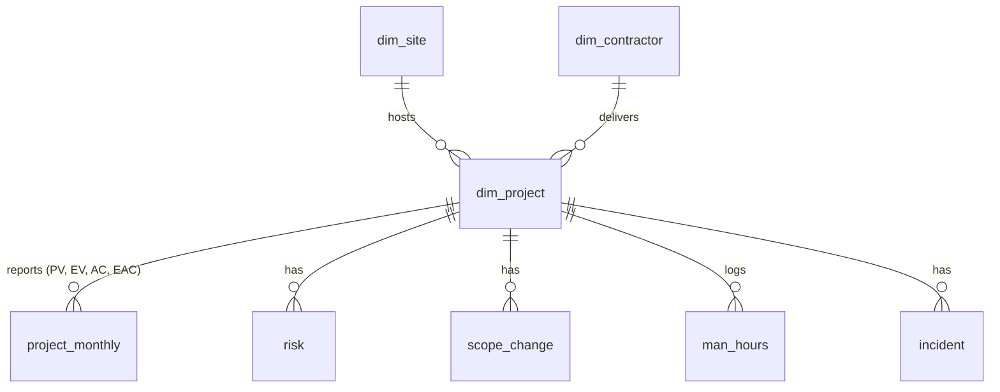

# Project Controls in SQL (SQLite)


**🇫🇷** Le contrôle de projets d'un portefeuille minier (valeur acquise, dépassement prévisionnel, risques, sécurité) calculé **uniquement en SQL**. Les résultats sont **rapprochés chiffre par chiffre** du tableau de bord Power BI [mining-pmo-dashboard](https://github.com/harold92342/mining-pmo-dashboard) : 17 chiffres sur 17 concordent.

**🇬🇧** Project controls for a mining capital portfolio (earned value, forecast overrun, risks, safety) calculated **in SQL only**. The results are **reconciled figure by figure** with the [mining-pmo-dashboard](https://github.com/harold92342/mining-pmo-dashboard) Power BI report: 17 out of 17 figures match.

> 🔒 Les données sont **fictives** (portefeuille de 32 projets généré par script). / The data is **fictional** (a 32-project portfolio built by script).

---

## 🎯 Pourquoi ce projet / Why this project

- 🇫🇷 Un tableau de bord n'inspire confiance que si ses chiffres se vérifient. Ici, la même logique (dernier rapport de chaque projet à la date de référence, règle de décision, correction qualité) est réécrite en SQL, et un test compare le résultat au dashboard.
- 🇬🇧 A dashboard is only trusted if its numbers can be verified. Here the same logic (latest report of each project at the reporting date, decision rule, data-quality fix) is rewritten in SQL, and a test compares the result with the dashboard.

## 📊 Résultats / Results (snapshot 2026-09-30)

| Question | Résultat SQL / SQL result |
|---|---|
| Budget ? / On budget? | **CPI 0.80**. Forecast overrun **24.7 %** (**$140.8M** on a $570.8M budget) |
| Délais ? / On time? | **SPI 0.87**, up from 0.74 a year earlier (2025-09-30) |
| Que décider ? / What to decide? | 15 live projects: **3 Accelerate · 1 Sustain · 4 Recover · 4 Pause · 3 Terminate** |
| Où sont les risques ? / Where is the risk? | **15 overdue mitigations**, 5 of them on P011 *Pushback 4 Pre-strip* |
| Sécurité / Safety | **TRIFR 15.8** per million hours; worst contractor **Red Earth Mechanical (29.5)** |
| Périmètre / Scope | Budget added by scope changes vs forecast overrun: **r = 0.46** |

Top 3 forecast overruns (query 11): **P027** Primary Crusher Relocation (+$20.9M), **P011** Pushback 4 Pre-strip (+$13.9M), **P032** Underground Exploration Decline (+$8.4M).

## 🗂️ Les requêtes / The queries

| File | Question | SQL techniques |
|---|---|---|
| `sql/00_schema.sql` | Tables, keys, `CHECK` rules, indexes | DDL, foreign keys |
| `sql/01_views.sql` | Latest report per project, KPIs, decision rule, cleaned data | views, `JOIN` on `MAX()`, `CASE` |
| `sql/10_portfolio_kpis.sql` | Portfolio BAC, PV, EV, AC, EAC, CPI, SPI, overrun | aggregates |
| `sql/11_project_evm_rag.sql` | Per-project earned value with a RAG status | `CASE`, ranking |
| `sql/12_decision_rule.sql` | Accelerate / Sustain / Recover / Pause / Terminate | `GROUP BY`, `GROUP_CONCAT` |
| `sql/13_monthly_trend.sql` | Monthly CPI and SPI, spend per month, moving average | CTEs, correlated subquery, `LAG()`, `AVG() OVER` |
| `sql/14_scope_change_vs_overrun.sql` | Budget added by scope changes, per project | `LEFT JOIN`, `COALESCE` |
| `sql/15_correlations.sql` | Pearson correlation computed in SQL | sums, `sqrt()`, `UNION ALL` |
| `sql/16_overdue_mitigations.sql` | Overdue risk mitigations to escalate | date logic, `julianday()` |
| `sql/17_safety_by_contractor.sql` | TRIFR by contractor | views, `UNION ALL` total row |
| `sql/18_data_quality_checks.sql` | 9 data-quality checks | `LAG()`, named `WINDOW` |

### Règles métier / Business rules

- **CPI** = EV / AC · **SPI** = EV / PV · **Forecast overrun** = EAC − BAC (BAC = budget after approved scope changes).
- 🇫🇷 Les valeurs PV / EV / AC sont **cumulées** : on lit le **dernier rapport** de chaque projet à la date de référence, on ne somme jamais les mois.
- 🇬🇧 PV / EV / AC are **cumulative**: each project's **latest report** at the reporting date is used; months are never added up.
- **Decision rule**: Accelerate (value ≥ 4, CPI ≥ 0.9, SPI ≥ 0.9) · Terminate (value ≤ 3, CPI < 0.75 or SPI < 0.6) · Recover (value ≥ 4) · Sustain (CPI ≥ 0.85, SPI ≥ 0.85) · Pause (others).
- **RAG** (illustrative): Red below 0.80, Amber below 0.95, Green otherwise, on CPI or SPI.
- **Data-quality fix**: man-hours (57 rows) and incidents (81 rows) booked after a project stopped reporting are excluded, as in the Power Query step of the dashboard. Rows go from 507 to 450 and from 750 to 669.

## ✅ Rapprochement avec le dashboard / Reconciliation

`python tests/reconcile.py` rebuilds the database and compares 17 figures with the published dashboard.

| Figure | SQL | Dashboard |
|---|---:|---:|
| CPI / SPI | 0.80 / 0.87 | 0.80 / 0.87 |
| Forecast overrun | 24.7 % (≈ $141M) | 24.7 % (≈ $141M) |
| Live projects by decision | 3 / 1 / 4 / 4 / 3 | 3 / 1 / 4 / 4 / 3 |
| Overdue mitigations | 15 | 15 |
| TRIFR (all / Red Earth Mechanical) | 15.8 / 29.5 | 15.8 / 29.5 |
| Rows after the fix (man-hours / incidents) | 450 / 669 | 450 / 669 |
| Correlations (scope vs overrun, stop-work vs SPI) | 0.46 / −0.41 | 0.46 / −0.41 |

## 🧱 Modèle de données / Data model



## ▶️ Lancer le projet / Run it

Only Python 3.9+ is needed (standard library). SQLite 3.35+ is required for `sqrt()`; Python 3.12 or newer ships a recent enough version.

```bash
git clone https://github.com/harold92342/project-controls-sql.git
cd project-controls-sql
python build_db.py                          # builds project_controls.db from data/*.csv
python run_queries.py                       # runs all queries, saves CSV files in results/
python run_queries.py --snapshot 2025-09-30 # same analysis at another month end
python tests/reconcile.py                   # checks the figures against the dashboard
```

You can also open `project_controls.db` in any SQLite tool (DB Browser for SQLite, DBeaver, VS Code) and run the files in `sql/` yourself.

## ⚠️ Limites / Limitations

- 🇫🇷 Données **synthétiques** : elles servent à montrer la méthode, pas à tirer des conclusions sur une vraie mine.
- 🇬🇧 **Synthetic** data: it shows the method; it says nothing about a real mine.
- 🇫🇷 Les seuils de la règle de décision et du RAG sont des **exemples** à valider avec un comité de pilotage.
- 🇬🇧 The decision-rule and RAG thresholds are **examples** to agree with a steering committee.
- 🇫🇷 Une corrélation (0.46) montre que deux mesures évoluent ensemble, pas que l'une cause l'autre.
- 🇬🇧 A correlation (0.46) shows two measures move together, not that one causes the other.
- 🇫🇷 SQLite convient à ce volume (quelques centaines de lignes). Un portefeuille réel passerait par PostgreSQL ou SQL Server.
- 🇬🇧 SQLite fits this volume (a few hundred rows). A real portfolio would use PostgreSQL or SQL Server.

## 📁 Structure

```
project-controls-sql/
├── build_db.py          # CSV -> SQLite
├── run_queries.py       # runs sql/1x_*.sql, prints and saves results
├── data/                # 8 CSV tables (from mining-pmo-dashboard)
├── sql/                 # schema, views and 9 analysis queries
├── results/             # query results as CSV (snapshot 2026-09-30)
└── tests/reconcile.py   # SQL vs dashboard
```

## 👤 Auteur / Author

**Timothée Kabwe** — Project & Data Professional, PMP®
[LinkedIn](https://www.linkedin.com/in/timkabwe/) · [Portfolio](https://harold92342.github.io/TimPortfolio) · [Power BI dashboard](https://github.com/harold92342/mining-pmo-dashboard) · MIT License
